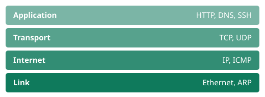

# Foundations overview

A network moves data in layers. Each layer does one job and hands the result to the next.

Read the layers from the bottom up, starting with [Ethernet](01-layers/01-link/01-ethernet.md).
