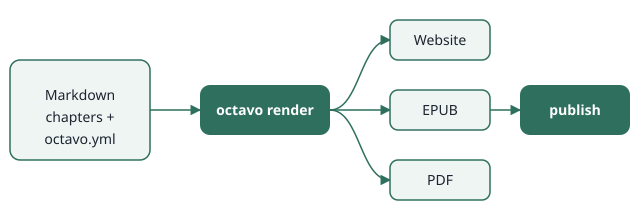

# Welcome

Octavo turns a folder of Markdown files into a book. One command builds it three ways: as a **website** you can host anywhere, as an **EPUB** for e-reader apps, and as a **PDF** laid out like a printed book. Another command publishes it.



This guide is for **Octavo {{octavo-version}}**. It ships inside the `octavo` program, so the guide you open always matches the version you run:

```sh
octavo guide                  # this guide, in your browser
octavo guide --to pdf         # save it as a PDF (or epub)
```

## This guide is a book written with Octavo

Everything described here is used somewhere in these pages: parts and sections, callouts, code, tables, footnotes, images and links between chapters. To see how any of it is written, take a copy of the guide's source and open it as your own book:

```sh
octavo guide --copy my-guide
cd my-guide
octavo preview --open
```

> [!TIP]
> Reading on a small screen, or want only the text? Press <kbd>Z</kbd> for zen mode. It hides the chapter list and the "On this page" list. Press <kbd>Z</kbd> or <kbd>Esc</kbd> to bring them back.

## How this guide is organised

- [Getting started](content/01-start/01-install.md): install Octavo, make a first book, and preview it while you write.
- [Writing](content/02-writing/01-chapters.md): chapters (new ones join by their number), Markdown, callouts and drafts.
- [Formats](content/03-formats/01-choosing.md): the website (with offline reading), the EPUB and the PDF (set by Typst or a browser), and how to change their look.
- [Libraries](content/04-libraries/01-libraries.md): several books on one site, with a portal page.
- [Publishing](content/05-publishing/01-publishing.md): send the book to GitHub Pages (also on every push, with GitHub Actions), an FTP host, your own server or anywhere else; keep older versions online.
- [Reference](content/06-reference/01-commands.md): every command, flag and setting on one page each.
